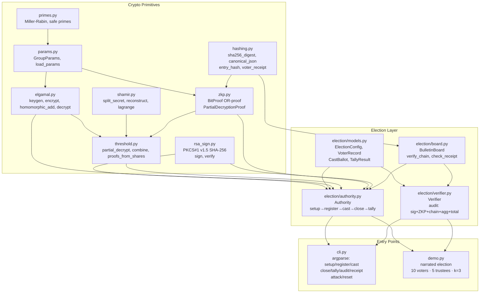

# SecureVote

A verifiable electronic voting system built from scratch in Python 3.10+, implementing the key primitives of modern cryptographic voting schemes — all with pure-Python big integers and no external cryptographic libraries at runtime.

> **Educational code only.** Not constant-time. Not production-grade. Not for real elections.

---

## Architecture



### Election flow

```mermaid
sequenceDiagram
    participant D as Dealer / Authority
    participant T as Trustees (1..n)
    participant V as Voters
    participant B as Bulletin Board
    participant A as Auditor

    D->>D: generate GroupParams (p,q,g), keygen → (x, h)
    D->>T: Shamir-split x: share x_i to trustee i
    D->>D: publish h, h_i = g^{x_i} per trustee; wipe x
    V->>V: register → RSA keypair (private key kept)
    loop For each voter
        V->>V: encrypt vote: (c1,c2) = (g^r, g^m · h^r)
        V->>V: OR-proof: prove m ∈ {0,1}
        V->>V: sign(election_id ∥ ciphertext ∥ proof)
        V->>B: submit ballot
        B->>B: verify: on roll? sig valid? not voted? ZKP valid?
        B->>V: issue receipt = H(c1,c2,election_id,timestamp)
    end
    D->>B: close()
    loop Each trustee i
        T->>T: d_i = c1^{x_i}, prove EQ-DL(g,h_i,c1,d_i)
    end
    D->>D: aggregate = ∏ ciphertexts, Lagrange-combine d_i → c1^x
    D->>D: g^m = c2 / c1^x, brute-force dlog → total YES
    D->>B: publish TallyResult
    A->>B: re-verify signatures, ZKPs, hash chain, aggregate, total
    A-->>A: PASS / FAIL per check
```

---

## Math Summary

### Group Parameters

A safe prime `p = 2q + 1` (q prime) is generated. The multiplicative group `Z_p*` contains a unique cyclic subgroup of order `q` — the quadratic residues. Generator `g` satisfies `g^q ≡ 1 (mod p)`.

All ciphertexts and proof elements are validated to lie in this subgroup: `1 < y < p` and `y^q ≡ 1 (mod p)`.

### Exponential ElGamal

| Symbol | Meaning |
|--------|---------|
| `x ∈ Z_q` | Private key |
| `h = g^x` | Public key |
| `(c1, c2) = (g^r, g^m · h^r)` | Encryption of vote `m ∈ {0,1}` |
| `(c1·c1', c2·c2')` | Homomorphic addition → encrypts `m + m'` |
| `T = c2 · (c1^x)^{-1} = g^m` | Decryption to `g^m`, then brute-force dlog |

### Shamir Secret Sharing (threshold k-of-n)

Polynomial `f(X) = x + a₁X + … + a_{k-1}X^{k-1}` over `Z_q`. Trustee `i` receives `f(i)`. Any `k` shares reconstruct `x = f(0)` via Lagrange interpolation:

```
x = Σᵢ f(i) · λᵢ(0)    where    λᵢ(0) = ∏_{j≠i} (-j)/(i-j)  mod q
```

Trustees **never** combine shares to recover `x`. Instead each contributes `d_i = c1^{x_i}` and the authority forms `c1^x = ∏ d_i^{λᵢ}` entirely in the exponent.

### Chaum-Pedersen OR-Proof (ballot validity)

For ciphertext `(c1, c2)`, define `y_i = c2 / g^i`. Branch `i` proves `(g, h, c1, y_i)` is a Diffie-Hellman tuple (log_g(c1) = log_h(y_i) = r). The Cramer-Schoenmakers-Gennaro construction simulates the false branch with random `(e_s, z_s)`, commits to the true branch, then uses Fiat-Shamir to bind both branches:

```
e = H(election_id ∥ h ∥ c1 ∥ c2 ∥ a₀ ∥ b₀ ∥ a₁ ∥ b₁) mod q
e₀ + e₁ ≡ e (mod q)
```

### Chaum-Pedersen Partial-Decryption Proof

Trustee `i` proves `log_g(h_i) = log_{c1}(d_i) = x_i` without revealing `x_i`:

```
A = g^w,  B = c1^w
e = H(g ∥ c1 ∥ h_i ∥ d_i ∥ A ∥ B) mod q
z = w + e·x_i  mod q
Verify: g^z = A·h_i^e   AND   c1^z = B·d_i^e
```

### Bulletin Board Hash Chain

```
genesis_prev_hash = "00…0"  (64 hex zeros)
entry_hash_i = SHA-256(UTF-8(prev_hash_{i-1}) ‖ canonical_JSON(index, voter_id, ballot, sig, ts))
```

Any deletion, edit, or reordering breaks the chain; `verify_chain()` returns the first broken index.

### Voter Receipt

```
receipt = SHA-256(canonical_JSON({ciphertext: [c1,c2], election_id, timestamp}))
```

The voter retains this 64-character hex token and can verify it appears on the public board.

---

## Project Structure

```
securevote/
├── crypto/
│   ├── primes.py        Miller-Rabin, random_safe_prime
│   ├── params.py        GroupParams, load_params (test / demo)
│   ├── elgamal.py       keygen, encrypt, homomorphic_add, decrypt
│   ├── shamir.py        split_secret, reconstruct_secret, lagrange
│   ├── threshold.py     partial_decrypt, combine, proofs_from_shares
│   ├── zkp.py           BitProof, PartialDecryptionProof
│   ├── rsa_sign.py      PKCS#1 v1.5, generate_rsa_keypair, sign/verify
│   └── hashing.py       sha256_digest, canonical_json, entry_hash
├── election/
│   ├── models.py        ElectionConfig, VoterRecord, CastBallot, TallyResult
│   ├── authority.py     Authority class (full election lifecycle)
│   ├── board.py         BulletinBoard, BoardEntry, verify_chain, check_receipt
│   └── verifier.py      Verifier class (independent audit)
├── tests/
│   ├── test_phase1_primes.py
│   ├── test_phase1_elgamal.py
│   ├── test_phase2_shamir_threshold.py
│   ├── test_phase3_rsa_sign.py
│   ├── test_phase4_zkp.py
│   ├── test_phase5_board.py
│   ├── test_phase6_election.py
│   └── test_phase7_attacks.py
├── docs/
│   └── PROGRESS.md
├── cli.py               argparse CLI (9 subcommands)
└── demo.py              narrated demo election
```

---

## Installation

```bash
pip install rich pycryptodome
```

`pycryptodome` is used **only in tests** for cross-checking RSA signatures. All runtime cryptography uses Python standard library (`hashlib`, `hmac`, `secrets`) and big integers.

---

## Usage

### Narrated demo (recommended starting point)

```bash
# Fast (~64-bit test params, instant)
python securevote/demo.py

# Full 2048-bit RFC 3526 params (takes longer)
python securevote/demo.py --params demo
```

### CLI walkthrough

```bash
# 1. Initialise election (5 trustees, threshold 3, 10 voters)
python -m securevote.cli setup --voters 10 --trustees 5 --threshold 3 --params test

# 2. Register voters (generates RSA keypairs)
python -m securevote.cli register --count 10

# 3. Cast ballots
python -m securevote.cli cast --voter voter-001 --choice yes
python -m securevote.cli cast --voter voter-002 --choice no

# 4. Close the election
python -m securevote.cli close

# 5. Tally with 3 trustees
python -m securevote.cli tally --trustees 1,2,3

# 6. Independent audit
python -m securevote.cli audit

# 7. Verify your receipt
python -m securevote.cli receipt --voter voter-001

# 8. Demo attack scenarios
python -m securevote.cli attack double_vote
python -m securevote.cli attack unregistered_voter
python -m securevote.cli attack bad_signature
python -m securevote.cli attack modified_ciphertext
python -m securevote.cli attack forged_zkp_m5
python -m securevote.cli attack forged_zkp_neg1

# 9. Reset state
python -m securevote.cli reset
```

### Run tests

```bash
python -m pytest securevote/tests/ -v
# Expected: 133 passed
```

---

## Attack Scenarios Covered

| # | Scenario | Expected outcome |
|---|----------|-----------------|
| 1 | Valid ballot | Accepted |
| 2 | Double vote | Rejected: `already_voted` |
| 3 | Voter not on roll | Rejected: `not_registered` |
| 4 | Signature altered | Rejected: `invalid_signature` |
| 5 | Ciphertext modified after signing | Rejected: `invalid_signature` |
| 6 | Ballot encrypting m=5 with forged proof | Rejected: `invalid_zkp` |
| 7 | Ballot encrypting m=−1 | Rejected: `invalid_zkp` |
| 8 | Tally with k trustees | Correct result |
| 9 | Tally with k−1 trustees | Fails (ValueError) |
| 10 | Trustee gives wrong partial decryption | Detected via Chaum-Pedersen proof |
| 11 | Board entry deleted | Chain fails; first bad index reported |
| 12 | Board entry edited | Chain fails; first bad index reported |
| 13 | Published total altered | Audit fails |

---

## Limitations

This is an **educational prototype**. The following properties are absent and would be required in any real deployment:

### Anonymity / Voter Privacy

The authority (server) sees both **who** submitted a ballot and **when**, allowing timing correlation between voter identity and ballot ciphertext. True anonymity requires either a blind-signature token scheme (voters obtain an anonymous token, then submit through a mix-net) or a commitment-reveal + re-encryption mix-net.

### Trusted Dealer

Shamir secret sharing requires a trusted dealer who temporarily holds the full election private key `x` before splitting it. A malicious or compromised dealer can learn `x`. Production systems use distributed key generation (DKG) so no single party ever knows `x`.

### Coercion Resistance

Voters can prove how they voted to a coercer by showing their randomness `r`. The system provides no mechanism for a voter to deny or fake a coercion proof. Receipt-freeness requires additional primitives (e.g., Benaloh challenge, Helios challenge-and-randomise).

### Demo Scale Only

Decryption uses brute-force discrete logarithm search (`O(N)` in the vote count). This is fast for `N ≤ 10,000` but impractical for large elections. Baby-step giant-step or Pollard-rho would scale to millions.

### No Constant-Time Guarantees

Python big-integer arithmetic is not constant-time. All modular exponentiations leak timing information through the Python interpreter. A production implementation would use libgmp with blinding or a hardware security module.

### Single-Candidate Ballots Only

Each ballot encodes one binary choice (YES/NO). Multi-candidate elections would require a sum-equals-1 proof across multiple ciphertexts.

---

## References

1. Cramer, R., Gennaro, R., Schoenmakers, B. (1994). *A secure and optimally efficient multi-authority election scheme.*
2. Chaum, D., Pedersen, T. P. (1992). *Wallet databases with observers.*
3. Shamir, A. (1979). *How to share a secret.* CACM 22(11).
4. RFC 3526 — *More Modular Exponential (MODP) Diffie-Hellman groups for IKE.*
5. RFC 8017 — *PKCS #1: RSA Cryptography Specifications Version 2.2.*
